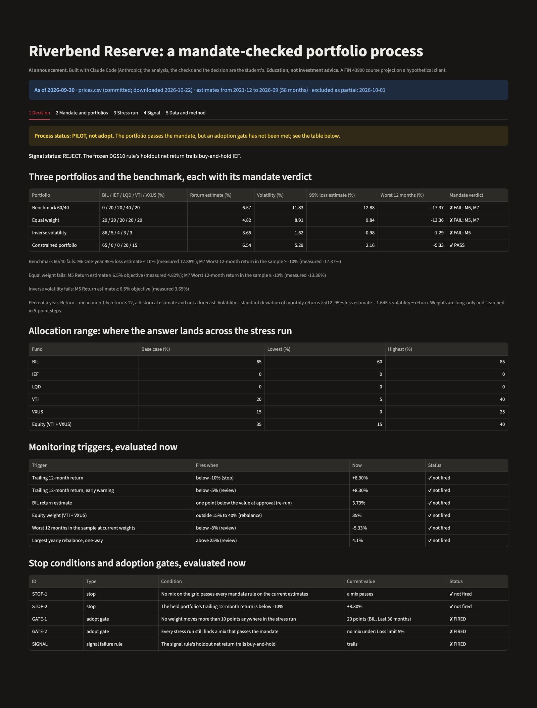
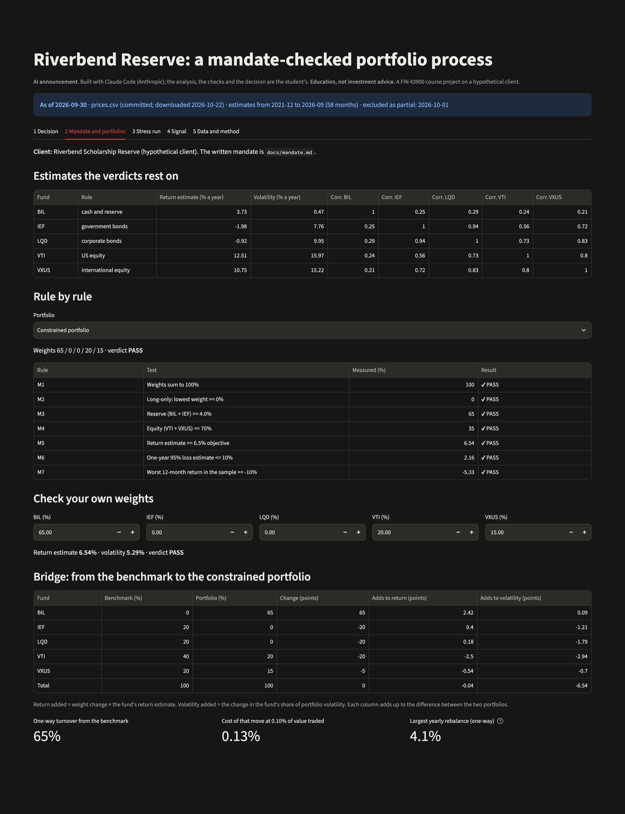
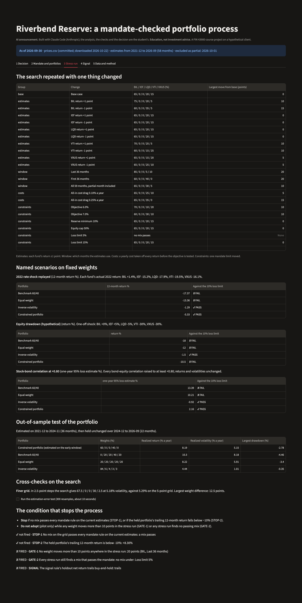
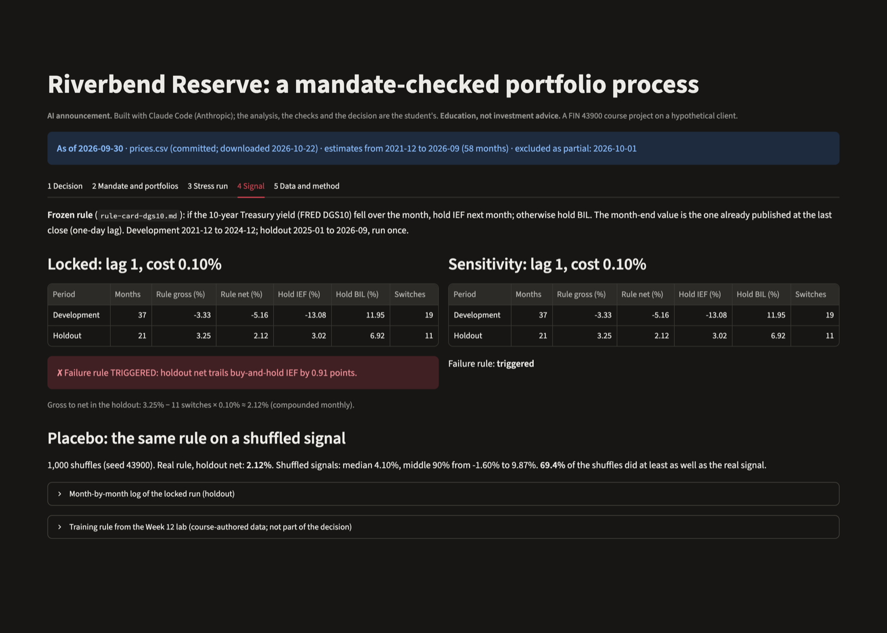
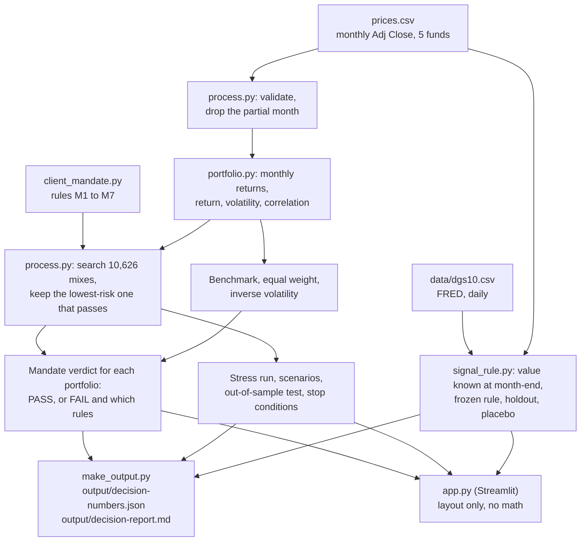

# Project 2: Riverbend Reserve, a mandate-checked portfolio process

[](https://github.com/Jesstran12/Portfolio-Project2-/actions/workflows/ci.yml)

> **AI announcement.** I used Claude Code (Anthropic, model Claude Fable 5.2) to help me build
> this project. Claude wrote most of the code and the tests, drafted the documents, and proposed
> the mandate numbers. I chose the funds, downloaded the prices, wrote the changed-input
> prediction with AI closed, checked the AI's output, and made the decision. The analysis and
> the decision are mine. The full record is in
> [docs/validation-and-ai-use.md](docs/validation-and-ai-use.md).
>
> **Education, not investment advice.** This is a FIN 43900 course project on a hypothetical
> client, and nothing in it is a recommendation to buy or sell.

## The decision

**Pilot the constrained portfolio for twelve months; do not adopt it as standing policy yet.
Reject the DGS10 timing signal.** As of **2026-09-30**.

| | |
|---|---|
| Intended user | The three-person investment committee of the Riverbend Scholarship Reserve, a hypothetical $5 million reserve that pays out 4% a year |
| Action requested | Approve a twelve-month pilot of the constrained portfolio inside the range below, and answer one question about the loss limit |
| Horizon and rebalancing | Five years or longer; reviewed every quarter, rebalanced once a year or when a trigger fires |
| Constraints | Long-only; BIL + IEF at least 4%; VTI + VXUS at most 70%; return estimate at least 6.5%; twelve-month loss no worse than 10%, measured two ways ([docs/mandate.md](docs/mandate.md)) |
| Target weights | BIL 65 / IEF 0 / LQD 0 / VTI 20 / VXUS 15: return estimate 6.54%, volatility 5.29%, mandate verdict PASS |
| Allocation range | Equity (VTI + VXUS) 15% to 40%; Treasury bills (BIL) 60% to 85% |
| Why not adopt | The answer moves up to 20 points when the estimation window changes, and no portfolio survives a 5% loss limit |
| Reverses it | Stop if the portfolio loses more than 10% over twelve months or no mix passes the mandate. Adopt once no weight moves more than 10 points in the stress run |
| Editions | Project 2 has no Edition A or B (course ruling of 2026-10-14). The evidence they would have carried is in the memo, the validation record and the commit history |

The full argument is in [docs/decision-memo.md](docs/decision-memo.md).

## Results without running anything

- **[output/decision-report.md](output/decision-report.md)**: inputs with file hashes, the as-of
  date, estimates, every portfolio's mandate verdict, the stress run, the scenarios, the
  out-of-sample test, the stop conditions and the signal's holdout.
- [output/decision-numbers.json](output/decision-numbers.json): the same numbers as data. Every
  number quoted in this README and in the memo is tested against this file.
- Screenshots of the running app:

| | |
|---|---|
|  |  |
|  |  |

## Run it

Tested on Python 3.14.3 (macOS). No credentials, API keys or `.env` file are needed, and the app
runs offline from the data committed here.

```
python3 -m venv .venv
source .venv/bin/activate
pip install -r requirements.txt
```

**The one command that produces the result:**

```
python3 make_output.py
```

It prints the decision numbers and rewrites everything in `output/`. Then:

```
python3 -m streamlit run app.py     # the app, at http://localhost:8501
python3 -m pytest -q                # known-answer and failure tests
```

In the app, change one limit in the sidebar (for example the loss limit from 10 to 5) and read
the verdicts on the Decision tab.

## How it works



## Repository map

**The product**

| File | What it does |
|---|---|
| [app.py](app.py) | The Streamlit app. Layout only; it imports every number |
| [client_mandate.py](client_mandate.py) | The mandate as code: limits, benchmark, rules M1 to M7, the verdict |
| [process.py](process.py) | The pipeline: validation, estimates, the constrained search, bridges, stress run, scenarios, out-of-sample test, stop conditions |
| [portfolio.py](portfolio.py) | The engine from Labs 14 and 15: covariance, return, volatility, the weight grid |
| [signal_rule.py](signal_rule.py), [rule-card-dgs10.md](rule-card-dgs10.md) | The point-in-time signal: frozen DGS10 rule, holdout, placebo, revision check |
| [make_output.py](make_output.py) | The one command; writes [output/](output/) |
| [prices.csv](prices.csv), [data/](data/) | The committed data snapshots |
| [tests/](tests/) | Known answers, mandate rules, signal failure tests, stale-output and consistency tests |
| [requirements.txt](requirements.txt) | Pinned versions |
| [.github/workflows/ci.yml](.github/workflows/ci.yml) | On every push: install, run the tests, regenerate `output/` and fail if it differs |

**The written record**

| File | What it is |
|---|---|
| [docs/decision-memo.md](docs/decision-memo.md) | The two-page memo for the committee |
| [docs/validation-and-ai-use.md](docs/validation-and-ai-use.md) | Tests, limitations, AI-use log, the Locked Changed-Input Record, the cold run |
| [docs/mandate.md](docs/mandate.md) | The client's mandate |
| [docs/data-cards.md](docs/data-cards.md) | A data card for every material input |
| [docs/video-scripts.md](docs/video-scripts.md), [docs/manifest.md](docs/manifest.md) | Video scripts with timestamp indexes; the submission manifest |

**Lab files, not part of the Project 2 decision**

`mandate.py`, `backtest.py` and `rule-card.md` (the Meridian and Week 12 training exercises, kept
as known-answer tests), `asof.py`, `asof_app.py`, `buffett_app.py`, `panel_app.py`, `memos/`,
`.claude/skills/` and the `lab-*.md` write-ups. `SPEC.md` is the working plan for the build.

## Data sources

| Input | Source | Downloaded | As-of boundary |
|---|---|---|---|
| Fund prices, `prices.csv` | Yahoo Finance, monthly Adj Close for BIL, IEF, LQD, VTI, VXUS | 2026-10-22 | 2026-09-30 (the partial October row is excluded) |
| 10-year Treasury yield, `data/dgs10.csv` | FRED series [DGS10](https://fred.stlouisfed.org/series/DGS10) | 2026-11-23 | one-day publication lag, built into the rule |
| The same series as known on 2026-09-30 | ALFRED vintage | 2026-11-23 | used only to check for revisions (none) |
| Inflation assumption, 2.5% | The client's planning assumption | n/a | set with the mandate |

Definitions, transformations, exclusions, revisions and the checks against each source are in
[docs/data-cards.md](docs/data-cards.md). **Licensing:** Yahoo Finance data is used under its
[terms of service](https://legal.yahoo.com/us/en/yahoo/terms/otos/index.html) for personal,
non-commercial, educational use; FRED data under the [FRED terms of use](https://fred.stlouisfed.org/legal/).
**Privacy:** public market data only; no personal data, no credentials.

## How the system and my thinking changed

| Stage | What I had | What changed my mind |
|---|---|---|
| Lab 13 | A checker for Meridian's rules. A 97%-equity portfolio passed every rule | A loss limit with no measure cannot be tested, so the mandate here measures it two ways (M6, M7) and caps equity (M4) |
| Labs 14 and 15 | Baselines and a lowest-risk search; one answer, 65 / 0 / 0 / 30 / 5 | One point off one estimate moved a quarter of the money, so the answer became a range and the call became "pilot" |
| Lab 17 | A data card for DGS10, but the backtest used a course training series | The signal now uses DGS10 itself, as known on each date, on the same funds as the portfolio |
| Project 2 | One app with verdicts, a stress run and stop conditions | The 60/40 benchmark fails the client's own loss limit; the signal fails its holdout and is rejected |

## Known limitations

- **Short history.** 58 monthly returns, and they include the 2022 rate shock. Bond funds show
  negative return estimates, so the search holds no bonds. A different five years would give a
  different portfolio. This is why the decision is a pilot with a range.
- **Estimates are averages of the past, not forecasts.** BIL's 3.73% reflects recent short-term
  rates. If its estimate falls one point, 15 points move into US equity.
- **The 95% loss estimate assumes normal returns**, which understates bad years. The history
  replay (M7) and the scenarios are there for that reason.
- **A hypothetical 30% equity fall costs the target portfolio 10.5%**, just past the loss limit.
- **Prices were copied from Yahoo by hand** and Adj Close is restated after each distribution, so
  a fresh download will not match the price levels exactly.
- **5-point weight grid.** A 2.5-point grid lowers volatility from 5.29% to 5.18% and moves 12.5
  points between VTI and VXUS, so the split between the two equity funds is not reliable.
- **Estimation error.** In a bootstrap of the monthly returns, 24.3% of resamples have no passing
  portfolio, and equity ranges from 15% to 50%.
- **Costs are simple.** A flat 0.10% of value traded; no taxes (the client is tax-exempt), no
  bid-ask model, fund expense ratios only as they appear in Adj Close.
- **One signal, one test.** The DGS10 rule failed. Nothing here shows that no yield rule works.
- **The client is hypothetical.** The mandate numbers were proposed by AI and approved by the
  student.
