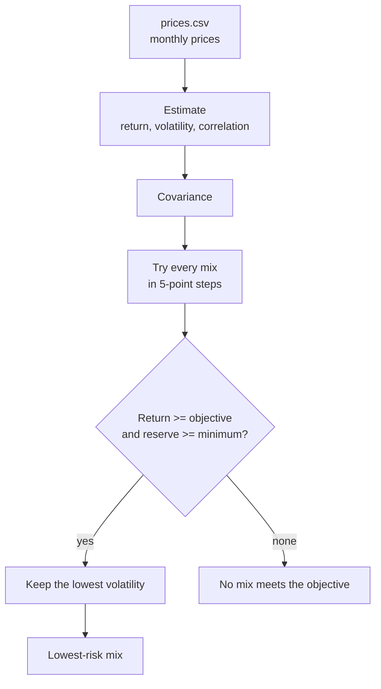

# Lab 15: Lowest-Risk Mix (Meridian, then my own funds)

**D: the question.** Which mix carries the least risk while meeting the mandate, and does the
answer survive a one-point change in one estimate?

Files: [`portfolio.py`](portfolio.py) (the engine, now with the search and the price estimates) and
[`app.py`](app.py) (the Streamlit app). Run them with `python3 portfolio.py`
and `python3 -m streamlit run app.py`.

**Short answer.** On Meridian, the lowest-risk mix is 0 / 20 / 25 / 55 (6.51%, 9.44%), and one point
off the equity estimate moves 25 points of the portfolio. On my own five funds, the answer moves 25
points between five years and the last three. My call is **pilot, not adopt**.

## R: my universe and my mandate

| Input | Meridian (training) | Mine |
| --- | --- | --- |
| Assets | the four sleeves from Lab 14 | BIL, IEF, LQD, VTI, VXUS |
| Return, volatility, correlation | Lab 14's tables | estimated from monthly Adj Close prices in `prices.csv` |
| Objective | 6.5% expected return | 6.5% expected return (same as Meridian) |
| Hard constraint | reserve-eligible at least 3% | reserve-eligible (BIL + IEF) at least 3% |

| Ticker | Fund | Role | Reserve-eligible |
| --- | --- | --- | --- |
| BIL | SPDR Bloomberg 1-3 Month T-Bill ETF | cash and reserve | yes |
| IEF | iShares 7-10 Year Treasury Bond ETF | government bonds | yes |
| LQD | iShares iBoxx $ Investment Grade Corporate Bond ETF | fixed income | no |
| VTI | Vanguard Total Stock Market ETF | US equity | no |
| VXUS | Vanguard Total International Stock ETF | international equity | no |

**Source and date.** Monthly **Adj Close** from Yahoo Finance (the chart data behind Historical
Data → Monthly, 5Y), downloaded **Oct 22, 2026**, for all five tickers. `prices.csv` holds 60 months,
Nov 2021 to Oct 2026, oldest first. The October 2026 price is as of Oct 21, 2026, part-way through
the month.

**Estimates, not forecasts.** Every return below is a historical average, labelled `estimate`.

| Estimate | BIL | IEF | LQD | VTI | VXUS |
| --- | ---: | ---: | ---: | ---: | ---: |
| Return, all months (estimate) | 3.71 | −1.45 | −0.40 | 12.33 | 10.04 |
| Volatility, all months | 0.47 | 7.79 | 9.94 | 15.83 | 15.17 |
| Return, last 36 months (estimate) | 4.30 | 4.53 | 6.48 | 22.05 | 19.43 |
| Volatility, last 36 months | 0.22 | 6.65 | 7.73 | 12.63 | 11.87 |

The bond funds show negative five-year returns because the window starts just before the 2022 rate
rises. The last 36 months leave that year out.

## V: proof on the known answer

| Run | Bills / 10-year / IG / equity | Return | Volatility |
| --- | --- | ---: | ---: |
| As loaded | 0 / 20 / 25 / 55 | 6.51 | 9.44 |
| Equity return box 8.0 → 7.0 | 0 / 10 / 10 / 80 | 6.53 | 12.94 |

Both match the lab. Largest weight change: **25 points** (equity, 55 → 80). One point off one
estimate moves a quarter of the money.

**Prove it is my engine.** With the IG–equity correlation set to 0.50 in `portfolio.py`, the app
showed **0 / 40 / 0 / 60** at **6.52** and **9.73**, as the lab expects. I then set it back to 0.25.
The app imports every calculation from `portfolio.py` and holds no copy of the math.

## Your universe: the answer

Objective 6.5%, reserve minimum 3%, BIL and IEF ticked.

| Window | BIL / IEF / LQD / VTI / VXUS | Return (estimate) | Volatility | Reserve-eligible |
| --- | --- | ---: | ---: | ---: |
| All months (60) | 65 / 0 / 0 / 30 / 5 | 6.61 | 5.46 | 65.00 |
| Last 36 months | 85 / 0 / 0 / 5 / 10 | 6.70 | 1.74 | 85.00 |

Largest weight change: **25 points** (VTI, 30 → 5; BIL, 65 → 85 is 20). In both windows the
search skips IEF and LQD: in the five-year window they lose money, and in the last 36 months BIL
earns almost as much with a fraction of the risk. The reserve rule never binds, because BIL alone
covers it many times over.

## Explain the code: the search

The search is `long_only_mixes` and `lowest_risk_mix` in `portfolio.py`.

- `long_only_mixes` splits 100 into 5-point steps across the assets (20 steps), every way possible,
  and yields each split as decimal weights. Five assets give 10,626 mixes.
- `lowest_risk_mix` builds the covariance once, then for each mix skips it if its return is below
  the objective or its reserve-eligible weight is below the minimum.
- Of the mixes left, it keeps the one with the lowest volatility. If none is left, it returns
  `None`, and the app shows "No mix meets the objective."

**Partner's question:** *(write your partner's question here)*

**My answer, from the code:** *(write your answer here)*

## Partner attack

**Estimate my partner moved:** *(which box, from what to what)*

**What the app showed, and my answer in two sentences:** *(fill in after the attack)*

## Your call

**Pilot, not adopt.** The lowest-risk mix depends on which history I estimate from: dropping the
first two years moves 25 points out of US equity and into T-bills, and the bond funds swing from
losing money to earning 4.5–6.5%. I would adopt only once the result holds in both windows and
under a one-point change in the equity estimate, and once the mandate states how the 10% loss rule
(S9) is measured.

## Estimation risk: learn on my own

1. **What it is.** The risk that the inputs to a model (expected returns above all) are wrong,
   because they are estimated from a short, noisy history.
2. **How it works.** The search picks whichever mix just clears the objective with the least risk.
   A small change in one expected return changes which assets clear it most cheaply, so the search
   swings to a different corner. It treats the estimates as exact, so it amplifies their errors.
3. **My own largest change.** On my five funds, switching from five years to the last three moved
   25 points, and on Meridian one point off the equity return also moved 25 points.

## Reflect

1. **Why the lowest-risk mix moved so far.** The answer sits exactly on the objective line, and
   the funds are close substitutes (IEF and LQD correlate 0.94; VTI and VXUS 0.80), so a small
   change in one estimate tips the search from one asset to its neighbour.
2. **What I would need to see before adopting it.** The same mix, within a few points, across both
   windows and under a one-point change in each return estimate, plus a measured answer to S9.

## How `portfolio.py` works

